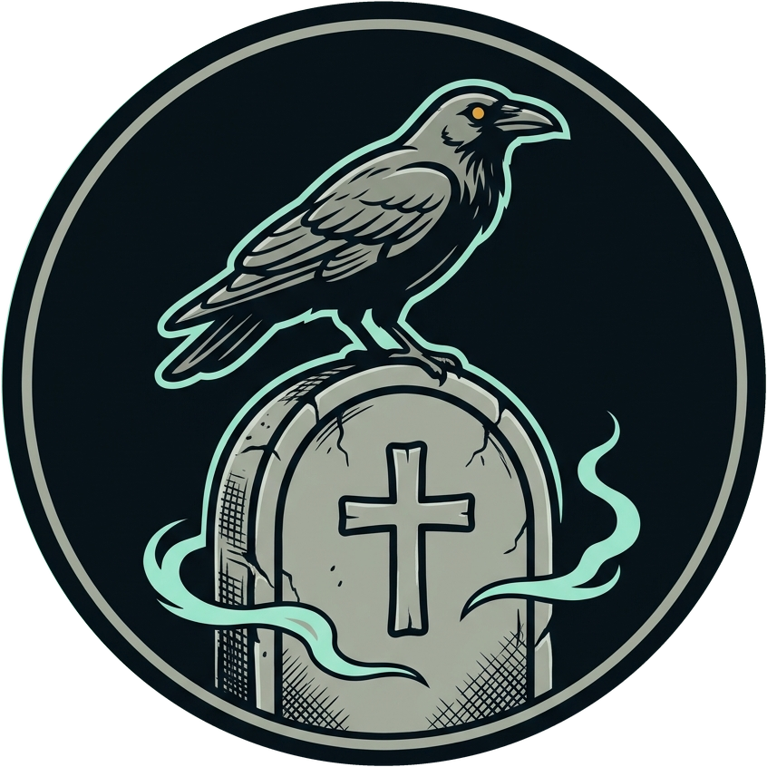

<p align="center">
  
</p>

<h1 align="center">Gravekeeper ($GRAVE)</h1>

<p align="center"><b>Here lies the supply.</b><br/>
An autonomous buyback-and-burn engine on <b>Robinhood Chain</b> (chain ID 4663), built for tokens launched on <a href="https://docs.ponsfamily.com/v2">Pons Family v2</a>.</p>

---

## How it works

Morrow, a crow that never leaves the yard, is the bot. The open plot is the dead address `0x000000000000000000000000000000000000dEaD`: whatever goes down stays down.

1. **Trades add a grain.** Every $GRAVE buy and sell pays a creator fee in ETH, collected in the Pons Fee Escrow.
2. **The glass runs through.** It collects up to the size of the next run: 0.01 ETH for a burial, 0.02 ETH for an offering.
3. **Morrow claims it.** The bot calls `escrow.claim()` on its own, 24/7.
4. **It buys $GRAVE.** For a burial, the claimed ETH market-buys $GRAVE on the Pons bonding curve (or Uniswap v4 after graduation).
5. **Burial or offering.** Odd runs send every token bought to `0x…dEaD`. Even runs send the fees to the project wallet.

## Status

The site is ready; the token is **not launched**. Before launch:

- Check `canLaunch` for the operator wallet: public launches on Pons are closed.
- Run a mainnet simulation of a sweep and a buy. The local test suite uses stand-ins, so `getLaunchedToken`, `sweepFees`, the hook sweep and the Uniswap v4 quote are not yet checked against the real contracts.

## Quick start

```bash
npm install
cp .env.example .env
npm run dev   # website on http://localhost:3095
npm run bot   # the bot and its API on port 5015 (PM2 and nginx use 5016, so it can share a VPS)
```

`CREATOR_PRIVATE_KEY` and `ADMIN_SECRET` stay on the server. Never commit `.env`. Deploy guide: [deploy/DEPLOY.md](deploy/DEPLOY.md).

Open `/memex` to set the token address and treasury; every change needs the Admin Secret.

## Testing

```bash
anvil --chain-id 4663 --port 8599
E2E_RPC=http://127.0.0.1:8599 npm run test:e2e
```

---

A meme, not financial advice.
